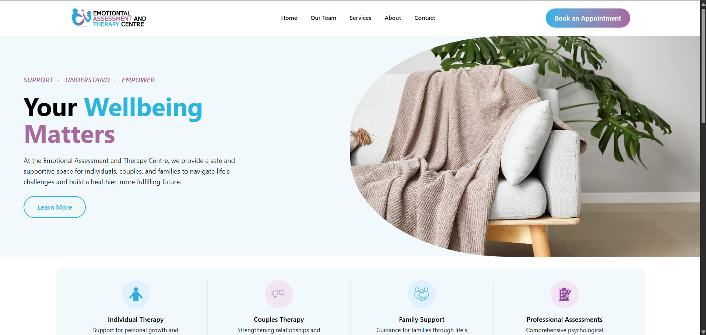
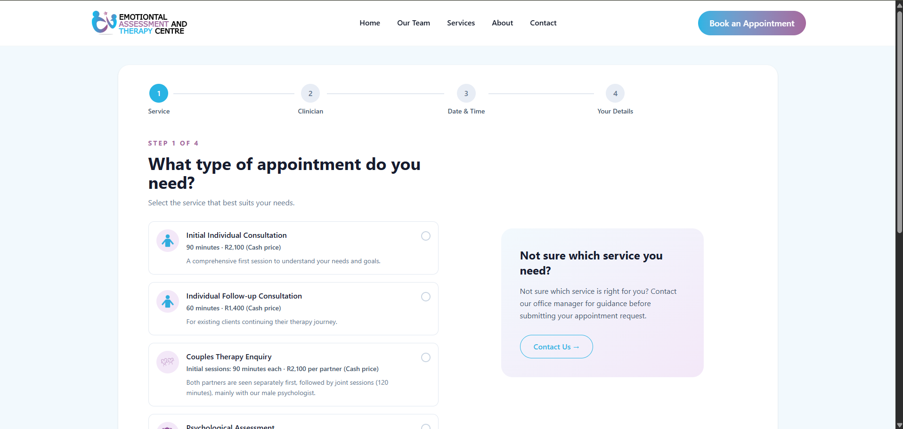
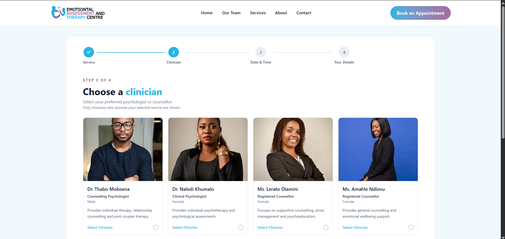
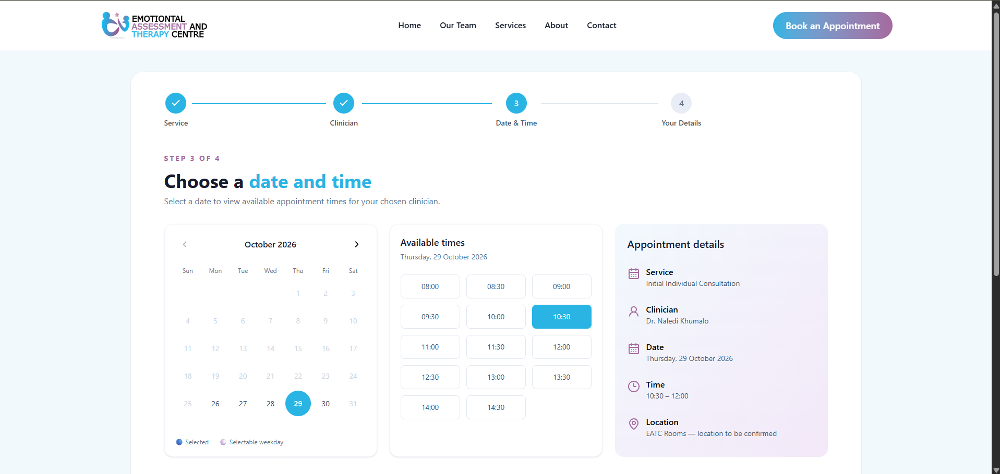
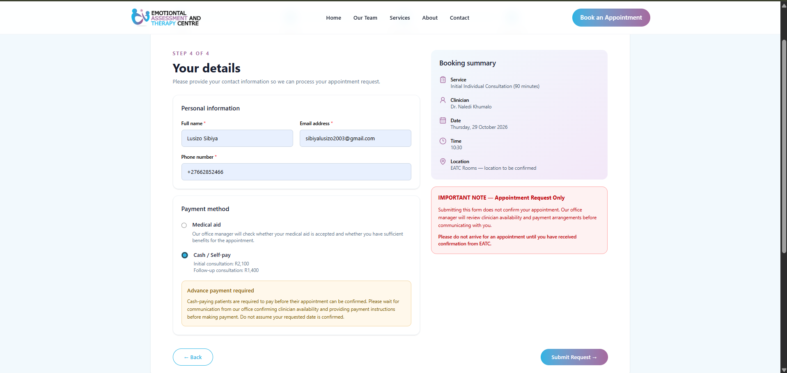
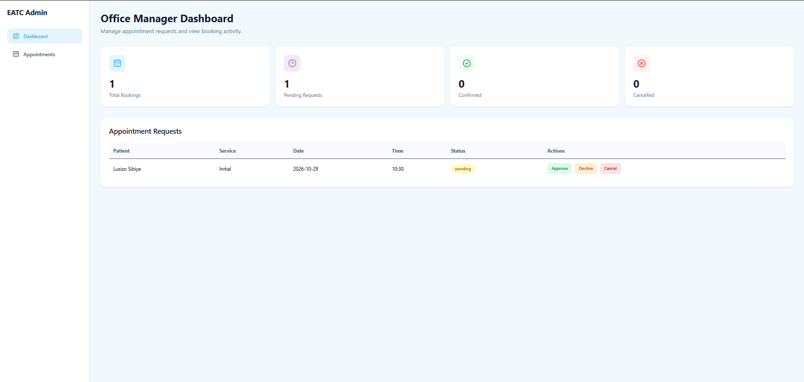

# EATC Appointment Booking System
A full-stack appointment booking prototype for Emotional Assessment and Therapy Centre (EATC), built with React, Tailwind CSS, Node.js and Express.

The system allows clients to submit appointment requests and gives an office manager a simple dashboard for reviewing and managing those requests.
Project status: Coursework/demo prototype. Use fictional test information only. This is not a deployed clinical booking system.

## Why I chose this project
I wanted to build something practical rather than another static website. I chose an appointment booking system for a psychological services centre because appointment scheduling involves more than simply selecting a date: different services require different session lengths, clinicians offer different services, and requests need to be reviewed by an office manager before they are confirmed.

The idea gave me an opportunity to practise both sides of web development while solving a realistic administrative problem. On the frontend, I could focus on creating a clear, welcoming booking experience. On the backend, I could apply what I have been learning about APIs, HTTP methods, validation and managing data.

It was also a useful challenge because I had to think through how the patient-facing website and the office manager's workflow connect. My aim was to build a foundation that could eventually grow into a more complete appointment management platform for EATC.

## What the system does
## Client booking flow
1. **Choose a service** — select an appointment type.
2. **Choose a clinician** — see clinicians who offer the selected service.
3. **Choose a date and time** — view time slots returned by the backend.
4. **Enter details and submit** — provide contact information and a payment preference.
Clients can indicate whether they intend to pay cash or use medical aid. Selecting medical aid displays additional fields for the office to review. After submission, the client sees an acknowledgement explaining that the request is pending, not a confirmed appointment.

## The dashboard displays submitted bookings, summary counts and their statuses. For the prototype, an office manager can:
- Review pending appointment requests.
- Approve or decline pending requests.
- Cancel pending or confirmed bookings.
- See booking statuses update in the dashboard.
Cancelling a booking changes its status rather than removing the record entirely.

## Appointment types and scheduling notes
Service	Current information
Initial Individual Consultation	90 minutes; R2,100 cash price
Individual Follow-up Consultation	60 minutes; R1,400 cash price
Couples Therapy Enquiry	Each partner is initially seen separately for 90 minutes (R2,100 per partner), followed by joint sessions of approximately 120 minutes; joint-session fees are to be confirmed
Psychological Assessment	Duration, fees and scheduling depend on the assessment


**Important prototype limitation:** The couples and assessment journeys still need dedicated enquiry/coordination logic. The current availability API is designed primarily around fixed-duration appointments; selecting a service in the interface should not be interpreted as a confirmed clinical booking. All requests remain subject to office review.

## Technologies used
**Frontend:** React, JavaScript, Vite, Tailwind CSS, React Router and Lucide React.

**Backend:** Node.js, Express and CORS.

**Development and testing:** VS Code, Postman, Git and GitHub.

## Project Structure

```text
eatc-booking-system/
├── client/
│   ├── public/
│   ├── src/
│   │   ├── assets/
│   │   ├── components/
│   │   │   ├── admin/
│   │   │   ├── booking/
│   │   │   └── layout/
│   │   ├── pages/
│   │   ├── App.jsx
│   │   └── main.jsx
│   └── package.json
├── server/
│   ├── data/
│   ├── routes/
│   ├── app.js
│   └── package.json
└── README.md
```

Some API routes are currently defined directly in server/app.js. The routes/ directory is available for future code organisation.

## How to run the project locally
**Requirements:** Node.js and npm.
1. Clone or download the repository.
2. Open the project in VS Code.
3. In one terminal, install and start the backend:

   `cd server`
   
   `npm install`

   `npm run dev`
4. In a second terminal, install and start the frontend:

   `cd client`

   `npm install`

   `npm run dev`
5. Open the frontend URL shown by Vite, normally http://localhost:5173.
On Windows PowerShell, if the npm command is restricted by the execution policy, use npm.cmd in its place.

**Local addresses:**
- Client booking website: http://localhost:5173/
- Booking flow: http://localhost:5173/booking
- Demo office dashboard: http://localhost:5173/admin
- Express API: http://localhost:3001
Keep both development servers running while testing.


## API Endpoints

The backend API was developed using Node.js and Express.

| Method | Endpoint | Description |
|--------|----------|-------------|
| GET | `/api/clinicians` | Retrieve available clinicians |
| GET | `/api/slots` | Retrieve appointment time slots |
| POST | `/api/bookings` | Submit a new booking request |
| GET | `/api/bookings/:date/:resource` | Retrieve bookings by date and clinician |
| DELETE | `/api/bookings/:id` | Cancel an appointment |
| GET | `/api/admin/bookings` | Retrieve all booking requests |
| PATCH | `/api/admin/bookings/:id/status` | Approve or decline a booking |


For the PATCH request, send JSON such as:

`{`
  
  `"status": "confirmed"`
  
`}`

Use "declined" to decline a pending request. The DELETE endpoint performs a soft cancellation by setting status to "cancelled".

## Testing
I tested the application through the React interface and used Postman to check the Express endpoints. Example scenarios included:
- Submitting a booking request and receiving a pending acknowledgement.
- Retrieving bookings by date and clinician.
- Checking that overlapping booking requests are rejected.
- Approving and declining requests through the admin workflow.
- Cancelling a booking and checking its updated status.
- Checking that the dashboard counts reflect booking status changes.

All demonstration bookings should use fictional patient details.

## Current limitations
This is a learning project, so several features are intentionally simplified:
- In-memory storage: Bookings are stored in a JavaScript array and reset when the Express server restarts.
- No staff authentication yet: The admin page and management endpoints are for local demonstration only and must not be publicly exposed with real patient data.
- No real medical-aid verification or payment processing: The system only collects a payment preference and, where relevant, medical-aid information for demonstration.
- No automated notifications: Email and SMS confirmations have not been integrated.
- Service-specific coordination is incomplete: Couples intake and psychological assessments need a separate enquiry workflow before real-world use.
- Availability is a prototype: Real clinician calendars, holidays, leave and working hours would need more detailed configuration.

## What I want to build next
My long-term goal is to grow this project beyond the coursework requirements into a more complete and reliable booking and appointment management platform.

**Future improvements I would like to explore include:**
1. Persistent database storage so bookings and status changes are saved across restarts.
2. Secure office manager login and role-based access to protect booking and patient information.
3. Email or SMS updates when requests are received, approved, declined or cancelled.
4. More flexible clinician schedules, including working hours, leave, unavailable dates and different appointment durations.
5. Dedicated couples therapy and assessment enquiries so the office can coordinate the appropriate consultation process.
6. Better appointment management, including rescheduling, calendar views, and filtering or searching requests.
7. Secure patient self-service options, such as checking booking status or requesting cancellation without necessarily creating an account.
8. Deployment and data protection work, including secure storage, access controls and privacy requirements before any real patient use.

## Application Screenshots

### Homepage


### Service Selection


### Clinician Selection


### Date and Time Selection


### Patient Details


### Office Manager Dashboard



## What I learned
Building this project helped me understand how a React frontend communicates with an Express backend. I practised React state management, props, conditional rendering, API calls with fetch(), Express routes, HTTP methods, validation and testing with Postman.

I also learned the importance of planning the user journey before coding, keeping components organised, testing changes incrementally and distinguishing between a booking request and an appointment confirmation.

This project is a starting point, and I plan to continue improving it as my software development skills grow.

---

> Built as a software development learning project.